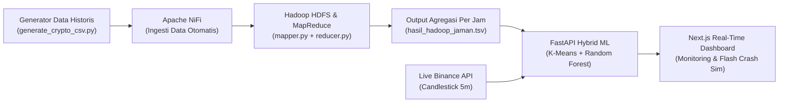

# 🛡️ CryptoShield — Big Data & Hybrid Machine Learning Crypto Volatility Detection System

**CryptoShield** adalah sistem deteksi volatilitas ekstrem (*flash crash*) dan prediksi risiko pasar aset kripto secara *real-time* yang menggabungkan pemrosesan **Big Data (Apache NiFi + Hadoop MapReduce)** dengan **Hybrid Machine Learning (K-Means Clustering + Random Forest)** serta dashboard interaktif berbasis **Next.js**.

---

## 📌 Daftar Isi
- [Gambaran Umum Arsitektur](#-gambaran-umum-arsitektur)
- [Fitur Utama](#-fitur-utama)
- [Struktur Proyek](#-struktur-proyek)
- [Teknologi yang Digunakan](#-teknologi-yang-digunakan)
- [Cara Menjalankan Proyek](#-cara-menjalankan-proyek)
  - [1. Tahap Data Generation & MapReduce (Big Data Pipeline)](#1-tahap-data-generation--mapreduce-big-data-pipeline)
  - [2. Menjalankan Backend API (FastAPI & Hybrid ML)](#2-menjalankan-backend-api-fastapi--hybrid-ml)
  - [3. Menjalankan Frontend Dashboard (Next.js)](#3-menjalankan-frontend-dashboard-nextjs)
- [Dokumentasi Endpoint API](#-dokumentasi-endpoint-api)

---

## 🏗️ Gambaran Umum Arsitektur

Sistem CryptoShield bekerja melalui 4 tahapan utama dari hulu ke hilir:



1. **Data Generation & Ingestion**: Script `generate_crypto_csv.py` mengambil sampel candlestick 5 menit (`5m`) dari Binance API untuk `BTCUSDT` dan `ETHUSDT`, lalu membangkitkan ~1,57 juta baris data historis (setara 15 tahun / 5.475 hari) ke dalam folder `NiFi_Input` untuk diingesti oleh **Apache NiFi** ke **Hadoop HDFS**.
2. **Distributed Aggregation (Hadoop MapReduce)**:
   - **`mapper.py`**: Memetakan setiap baris transaksi candlestick 5 menit ke kunci berbasis `KOIN_TANGGAL_JAM` (`YYYY-MM-DD HH:00:00`).
   - **`reducer.py`**: Mengagregasi data per jam untuk menghitung **Max Volatility** (`high - low`), **Average Volatility**, **Spike Ratio** (`max_vol / avg_vol`), **Total Volume**, dan waktu puncak lonjakan (**Peak Time**), menghasilkan file `hasil_hadoop_jaman.tsv`.
3. **Hybrid Machine Learning Engine (`api_live_ml.py`)**:
   - **Unsupervised Learning (`K-Means`, $k=3$)**: Mengelompokkan kondisi pasar saat ini ke dalam 3 rezim risiko otomatis yang diurutkan berdasarkan tingkat volatilitas:
     - `0` → **SAFE (GREEN)**: Pasar normal, bot trading tetap aktif.
     - `1` → **WARNING (YELLOW)**: Volatilitas tinggi, kurangi leverage / perketat manajemen risiko.
     - `2` → **DANGER (RED)**: Terdeteksi *flash crash*, hentikan bot trading / perlebar *stop loss* segera.
   - **Supervised Learning (`Random Forest Classifier & Regressor`, 1.000 trees)**: Memprediksi probabilitas perpindahan rezim risiko pada periode berikutnya (**Jam +1**) serta mengestimasi besaran volatilitas (USD) untuk menentukan batas **Upper Resistance** dan **Lower Support / Stop Loss**.
4. **Real-Time Web Dashboard (`dashboard/`)**: Antarmuka komando berbasis Next.js + TypeScript + Tailwind CSS yang melakukan *polling* data setiap 5 detik dari FastAPI, dilengkapi grafik area perbandingan baseline historis dan panel **Simulasi Flash Crash** untuk pengujian/presentasi.

---

## ✨ Fitur Utama

- **Deteksi Rezim Pasar Real-Time (K-Means)**: Menampilkan status keamanan pasar saat ini (`SAFE`, `WARNING`, `DANGER`) beserta rekomendasi tindakan otomatis untuk bot trading.
- **Prediksi Risiko & Harga Jam +1 (Random Forest)**: Menyajikan distribusi probabilitas risiko periode selanjutnya (`% SAFE`, `% WARNING`, `% DANGER`) dan estimasi rentang harga *Upper Resistance* & *Lower Support*.
- **Integrasi Live Binance API & Smart Caching**: Mengambil data pasar langsung dari endpoint publik Binance (`interval=5m`) dengan *fallback cache* otomatis apabila koneksi internet terputus.
- **Mode Simulasi Flash Crash (Demo Control Bar)**: Memungkinkan pengujian skenario lonjakan harga ekstrem (`POST /api/simulate-crash`) secara instan dan mengembalikannya ke mode live (`POST /api/reset-simulation`) kapan saja.
- **Mode Preview / Simulasi Offline di Frontend**: Dashboard tetap dapat dijalankan dan didemokan meskipun server backend FastAPI sedang tidak aktif.

---

## 📂 Struktur Proyek

```text
D:\CryptoShield\
├── NiFi_Input/                  # Direktori dropzone input CSV untuk Apache NiFi
├── api_live_ml.py               # Server FastAPI + pipeline training & inferensi Hybrid ML
├── generate_crypto_csv.py       # Script generator 1,57 juta baris data historis (15 tahun)
├── mapper.py                    # Script Mapper untuk Hadoop Streaming (agregasi level jam)
├── reducer.py                   # Script Reducer untuk Hadoop Streaming (kalkulasi metrik volatilitas)
└── dashboard/                   # Aplikasi Frontend (Next.js 15 + React 19 + TypeScript + Tailwind CSS)
    ├── src/
    │   ├── app/                 # Konfigurasi App Router Next.js & global styles
    │   ├── components/          # Komponen UI modular:
    │   │   ├── CryptoShieldDashboard.tsx
    │   │   ├── HeaderBar.tsx
    │   │   ├── KMeansDetectionPanel.tsx
    │   │   ├── RandomForestForecastPanel.tsx
    │   │   ├── HistoricalBaselineSection.tsx
    │   │   └── DemoControlBar.tsx
    │   ├── lib/api.ts           # Klien HTTP FastAPI & generator data fallback offline
    │   └── types/cryptoshield.ts# Definisi kontrak tipe data TypeScript
    ├── package.json
    └── README.md
```

---

## 🛠️ Teknologi yang Digunakan

| Komponen | Teknologi |
| :--- | :--- |
| **Big Data Ingestion & Processing** | Apache NiFi, Apache Hadoop (HDFS & MapReduce Streaming), Python 3 |
| **Machine Learning & Data Science** | Scikit-Learn (`KMeans`, `RandomForestClassifier`, `RandomForestRegressor`, `StandardScaler`), Pandas, NumPy |
| **Backend API** | FastAPI, Uvicorn, Pydantic, Requests (Binance REST API) |
| **Frontend Dashboard** | Next.js 15 (App Router), React 19, TypeScript, Tailwind CSS, Lucide Icons |

---

## 🚀 Cara Menjalankan Proyek

### 1. Tahap Data Generation & MapReduce (Big Data Pipeline)

1. **Generate Dataset Historis CSV**:
   ```bash
   python generate_crypto_csv.py
   ```
   File `BTCUSDT_5m.csv` dan `ETHUSDT_5m.csv` akan dibuat di direktori `NiFi_Input/`.

2. **Jalankan MapReduce (via Hadoop Streaming atau Local Pipe)**:
   - **Menggunakan Hadoop Streaming**:
     ```bash
     hadoop jar $HADOOP_HOME/share/hadoop/tools/lib/hadoop-streaming-*.jar \
       -files mapper.py,reducer.py \
       -mapper "python3 mapper.py" \
       -reducer "python3 reducer.py" \
       -input /nifi_crypto_input/*.csv \
       -output /crypto_output_hourly
     
     hdfs dfs -getmerge /crypto_output_hourly D:\CryptoShield\hasil_hadoop_jaman.tsv
     ```
   - **Alternatif Pengujian Lokal (tanpa cluster Hadoop aktif)**:
     Pastikan file hasil agregasi tersimpan dengan nama `hasil_hadoop_jaman.tsv` di direktori utama `D:\CryptoShield\`.

---

### 2. Menjalankan Backend API (FastAPI & Hybrid ML)

1. Pastikan dependensi Python sudah terinstal:
   ```bash
   pip install fastapi uvicorn pandas numpy scikit-learn requests pydantic
   ```
2. Pastikan file `hasil_hadoop_jaman.tsv` berada di folder `D:\CryptoShield\`.
3. Jalankan server FastAPI:
   ```bash
   uvicorn api_live_ml:app --host 0.0.0.0 --port 8000 --reload
   ```
   Saat pertama kali dijalankan, server akan otomatis melatih model **K-Means** dan **Random Forest** untuk setiap koin (`BTCUSDT` & `ETHUSDT`) dan menampilkan log:
   `[READY] Model Hybrid ML berhasil dilatih untuk BTCUSDT (...)`

---

### 3. Menjalankan Frontend Dashboard (Next.js)

1. Buka terminal baru dan masuk ke direktori `dashboard`:
   ```bash
   cd D:\CryptoShield\dashboard
   ```
2. Instal paket dependensi Node.js:
   ```bash
   npm install
   ```
3. Jalankan server development Next.js:
   ```bash
   npm run dev
   ```
4. Buka browser dan akses **`http://localhost:3000`**.

---

## 📡 Dokumentasi Endpoint API

Server FastAPI berjalan di `http://localhost:8000` (Dokumentasi Swagger interaktif tersedia di `http://localhost:8000/docs`):

| Method | Endpoint | Parameter / Body | Deskripsi |
| :---: | :--- | :--- | :--- |
| `GET` | `/api/live-monitor` | `symbol` (default: `BTCUSDT`) | Mengambil data OHLCV 5m terbaru, hasil deteksi klaster **K-Means** saat ini, serta prediksi probabilitas & rentang harga **Random Forest** untuk periode berikutnya. |
| `GET` | `/api/historical-baseline` | `symbol` (default: `BTCUSDT`), `limit` (default: `365`) | Mengambil riwayat data agregasi Hadoop beserta label risiko historis untuk visualisasi grafik dan tabel baseline. |
| `POST` | `/api/simulate-crash` | JSON: `{"symbol": "BTCUSDT", "simulated_high": 86500.0, "simulated_low": 84200.0, "simulated_volume": 9500.0}` | Mengaktifkan mode simulasi *flash crash* pada koin tertentu untuk mendemonstrasikan respons sistem saat status berubah menjadi **DANGER (RED)**. |
| `POST` | `/api/reset-simulation` | Query: `symbol` (default: `BTCUSDT`) | Menonaktifkan mode simulasi dan mengembalikan pemantauan ke data *real-time* Binance API. |
